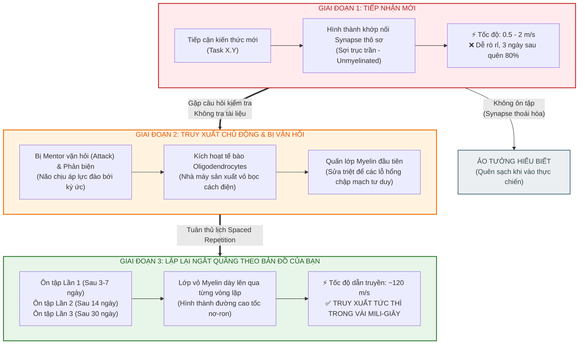
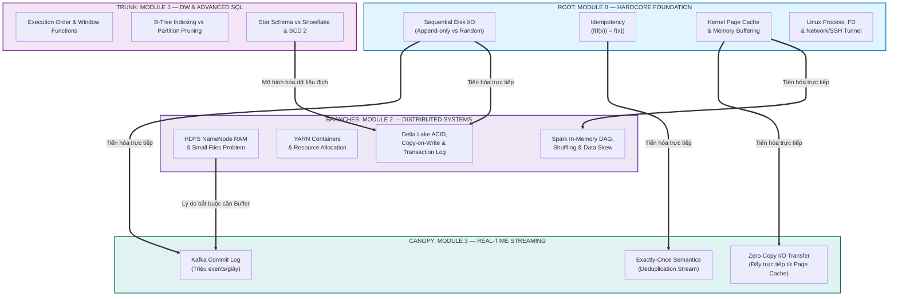

# 🧠 HỆ THỐNG LIÊN KẾT THẦN KINH & ÔN LUYỆN NGẮT QUÃNG
> **Triết lý:** *"Không nợ kỹ thuật — Dùng khoa học thần kinh để biến kiến thức nền tảng thành phản xạ vô điều kiện ở cấp độ Senior."*  
> **Nguồn cảm hứng:** Bản vẽ tay chiến lược ngày 27/09/2026 của học viên.

---

## ⚡ 1. NGUYÊN LÝ SINH HỌC: CƠ CHẾ BỌC BAO MYELIN (MYELINATION)

Trong não bộ, kiến thức không phải là những tệp tin tĩnh được lưu trữ, mà là **đường dẫn xung điện qua các sợi trục thần kinh (Axon)** kết nối các nơ-ron:

1. **Học mới lần đầu (Sợi trục trần - Unmyelinated):**
   - Xung điện truyền đi rất chậm (~0.5 - 2 m/s), tín hiệu bị rò rỉ, phân tán.
   - Hiện tượng: Đọc hiểu ngay lúc đó, nhưng 3 ngày sau quên 80%. Khi gặp bài toán thực tế thì lúng túng, không tự giải được.

2. **Chủ động truy xuất & Sửa sai (Active Recall & Error-driven Learning):**
   - Khi bị Mentor vặn hỏi, não buộc phải "đào bới" ký ức và trải qua áp lực nhận thức (*Cognitive struggle*).
   - Não tiết ra chất thúc đẩy các tế bào đệm (Oligodendrocytes) quấn lớp **Myelin** đầu tiên quanh sợi trục. Lớp Myelin này có tác dụng cách điện, giữ cho xung thần kinh không bị thất thoát.

3. **Lặp lại ngắt quãng (Spaced Repetition):**
   - Cứ mỗi lần ôn tập lại vào các mốc: **Ngày 1 → Ngày 3 → Ngày 7 → Ngày 14 → Ngày 30**, lớp vỏ Myelin lại được bọc thêm một tầng dày hơn.
   - **Kết quả:** Tín hiệu chuyển sang chế độ **Dẫn truyền nhảy vọt (Saltatory conduction)** qua các eo Ranvier. Tốc độ truyền dẫn tăng lên tới **120 m/s (nhanh gấp 100 - 200 lần)**. Lúc này, kiến thức đã biến thành **bản năng phản xạ vô điều kiện (Instinctive Architecture)**.

---

## 📊 2. SƠ ĐỒ TIẾN HÓA THẦN KINH QUA CÁC CHU KỲ ÔN TẬP

---

## 🌲 3. TRỤC XƯƠNG SỐNG LIÊN KẾT DỮ LIỆU (THE DATA ENGINEERING NEURAL SPINE)

Không học các công cụ như những ốc đảo biệt lập. Toàn bộ công nghệ Big Data hiện đại đều bắt rễ từ **Module 0**:

---

## 🧬 4. BẢNG BIẾN CHUYỂN FIRST PRINCIPLES (M0 ➔ BIG DATA)

| Khái niệm Gốc (Module 0) | Sợi Dây Liên Kết Thần Kinh | Công Nghệ Thực Chiến (Module 1, 2, 3) | Biểu Hiện Khi Bao Myelin Bị Lỏng (Lỗ Hổng Tư Duy) |
| :--- | :--- | :--- | :--- |
| **Sequential I/O** | Ghi tiếp vào đuôi file không xoay đĩa cơ học / không re-allocate block. | **WAL Log** (Postgres), **`_delta_log`** (Delta Lake), **Commit Log** (Kafka). | Nghĩ rằng Kafka hay Database nhanh vì "lưu trong RAM" thay vì hiểu bản chất đĩa ghi tuần tự. |
| **Idempotency** | $f(f(x)) = f(x)$ — Chạy lại 100 lần không đổi trạng thái. | **Staging SWAP** (Batch ETL), **Idempotency-Key + ON CONFLICT** (API/Real-time), **Deduplication** (Kafka Streaming). | Dùng cơ chế Staging Table của Batch đi giải quyết bài toán trừ tiền API Real-time; để mạng lag làm trừ tiền 2 lần. |
| **Small Files & I/O** | Mỗi file tốn 1 Inode & Data Block riêng, đọc nhiều file làm đầu từ nhảy loạn xạ. | **Small Files Problem** (HDFS làm chết NameNode RAM), **Compaction OPTIMIZE** (Delta Lake gom file 128MB-1GB). | Cho Streaming ghi trực tiếp từng record vào Data Lake, làm sinh ra hàng chục triệu file nhỏ/ngày. |
| **OS Page Cache** | Linux kernel tự động cache các trang đĩa thường dùng lên RAM còn trống. | **In-Memory Spark**, **Kafka Zero-Copy (sendfile system call)** bỏ qua User Space. | Lạm dụng RAM ứng dụng Java/JVM dẫn đến Garbage Collection (GC) pauses và OOM. |

---

## 📋 5. QUY ƯỚC ĐÁNH GIÁ ĐỊNH KỲ (THE REVIEW PROTOCOL)

Khi thực hiện ôn tập theo sơ đồ nhánh trên giấy của bạn:

1. **Vòng 1 (Ôn tập ngày):** Trả lời câu hỏi phản biện ngắn (dưới 5 phút) ở Tầng 3 (WHY) và Tầng 4 (FAILURE).
2. **Vòng 2 (Ôn tập lần 2 - Sau 7 ngày):** Giải quyết bài toán chéo kết hợp giữa Module cũ và Module hiện tại.
3. **Tiêu chuẩn "Vỏ Myelin Đạt Chuẩn":**
   - [ ] Trả lời không cần mở tài liệu hoặc Google.
   - [ ] Giải thích được **bản chất phần cứng / tài nguyên (RAM, CPU, Disk, Network)** bên dưới.
   - [ ] Nêu được kịch bản sụp đổ của hệ thống nếu không áp dụng cơ chế đó.
